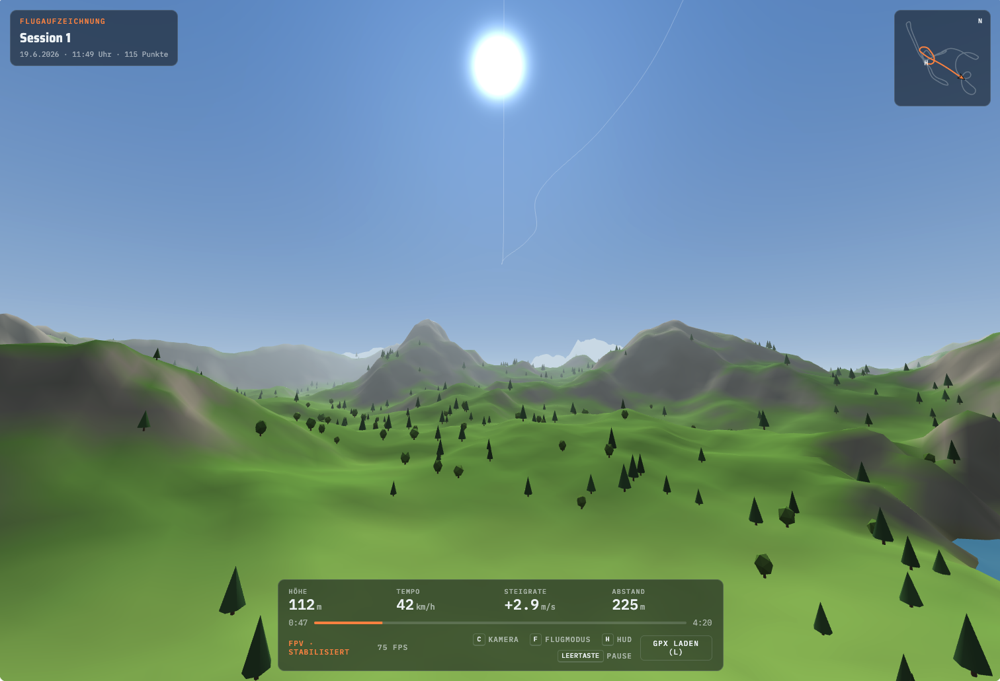

# FPV Flight Replay

A self-running 3D replay of a real quadcopter flight. A 4-inch FPV quad follows a GPS track from a GPX file or an EdgeTX/OpenTX telemetry log across procedurally generated terrain. It is a single HTML file with WebGL via [three.js](https://threejs.org/). There is no build step and no server, and the page makes no external requests.

**Live demo:** https://radla.github.io/fpv-flight-replay/



## Getting started

Open `index.html` in a browser (double-click is enough, `file://` works). On start it replays the embedded sample flight ("Session 1") in a loop.

`lib/three.min.js` must stay next to `index.html`.

## Controls

| Key | Action |
| --- | --- |
| `C` | Camera: FPV / launch point / chase |
| `F` | Flight mode (FPV only): stabilized / acro (roll) / acro (full) |
| `H` or tap | Show or hide the HUD |
| `L` | Load a track (GPX or EdgeTX/OpenTX CSV) |
| `Space` | Pause |

On touch devices the HUD has buttons for camera and loading instead.

### Cameras

- **FPV**: onboard camera, 12 cm in front of the quad.
- **Launch point**: stands at eye level next to the launch pad, follows the quad and zooms so the 18 cm quad stays visible at 300 m.
- **Chase**: 1.8 m behind and 0.6 m above the quad.

### Flight modes (FPV)

- **Stabilized**: level horizon, smoothed yaw and pitch.
- **Acro (roll)**: like stabilized, but the camera rolls with the quad.
- **Acro (full)**: camera fixed to the frame with 20° uptilt, follows roll and pitch.

## Supported files

### GPX

Uses `<trkpt>` (falls back to `<rtept>`) with `<ele>` and `<time>`. Without timestamps, 2 s between points is assumed.

### EdgeTX / OpenTX telemetry logs (CSV)

The SD card logs of EdgeTX/OpenTX radios, e.g. with ELRS or Crossfire telemetry. Required columns are `Date`, `Time` and `GPS` (`"lat lon"`). Altitude comes from `GAlt(...)` or `Alt(...)`; feet are converted.

- **Multiple flights per file:** a gap of more than 10 s between rows starts a new flight. If several flights contain GPS data, a picker with a route preview appears. A single GPS flight loads directly.
- **Flights without GPS** (no fix, or no GPS on board) are skipped. So are flights that never move more than 10 m from the start.
- **Repeated values:** Crossfire sends the GPS frame only about every 3 s, while the log repeats the last values every second. Only the first row of each new frame is used, otherwise the quad would stop and jump.

## How it works

1. **Coordinates:** latitude/longitude are projected to local meters (equirectangular around the track center). The lowest point of the track sits at ground level.
2. **Timing:** loggers often round timestamps to whole seconds, which makes the intervals alternate between 2 s and 3 s. A moving average over ±3 points restores the even rhythm.
3. **Motion:** a centripetal Catmull-Rom curve runs through the points. Distance over time is interpolated with a monotone cubic (Fritsch–Carlson), so speed changes smoothly and the quad never runs backwards.
4. **Attitude:** pitch and roll follow acceleration and air drag (a quad tilts into the direction it accelerates), low-pass filtered.
5. **Terrain:** simplex-noise hills and mountains, flat meadow within 45 m of the track (the quad never clips into the ground), a lake placed away from the route, about 2,600 instanced trees. Terrain size grows with the track.
6. **Performance:** one terrain mesh with vertex colors, instanced trees, no real-time shadows (a blob shadow instead), pixel ratio capped at 1.5. The HUD shows the current FPS.

## Configuration

Constants at the top of their sections in the `<script>` block of `index.html`:

| Constant | Default | Meaning |
| --- | --- | --- |
| `SPEED` | `2.5` | Playback speed relative to real time |
| `UPTILT` | `0.35` | FPV camera uptilt in full acro (radians, ~20°) |
| `SAMPLES` | `1400` | Points of the drawn route line |

The embedded sample flight lives in `<script type="text/plain" id="gpx">`. Replace its content with another GPX file to change the default track.

## Project layout

```
index.html        page, styles, fonts (embedded), sample track, application code
lib/three.min.js  three.js r128 (MIT)
```

## Third-party licenses

- **three.js r128**: MIT License, © 2010–2021 three.js authors. The license header is kept in `lib/three.min.js`. See <https://github.com/mrdoob/three.js/blob/dev/LICENSE>.
- **Saira Semi Condensed** and **IBM Plex Mono** (Latin subset, embedded as WOFF2 data URIs in `index.html`): SIL Open Font License 1.1. See <https://openfontlicense.org>.
